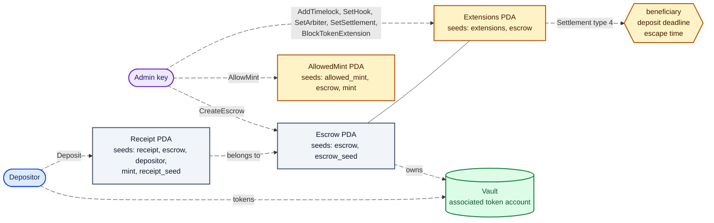
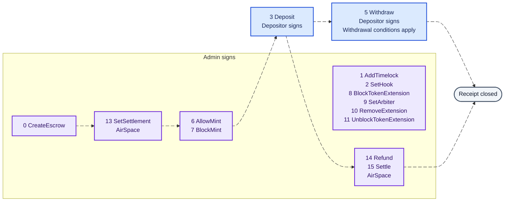
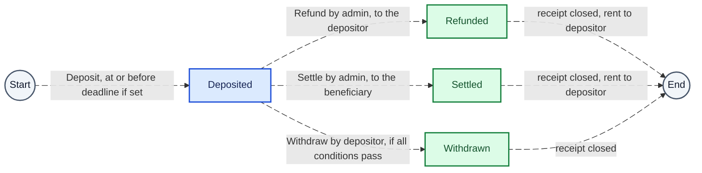
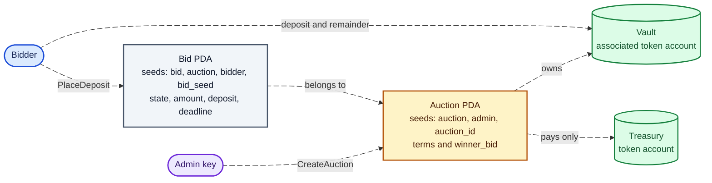
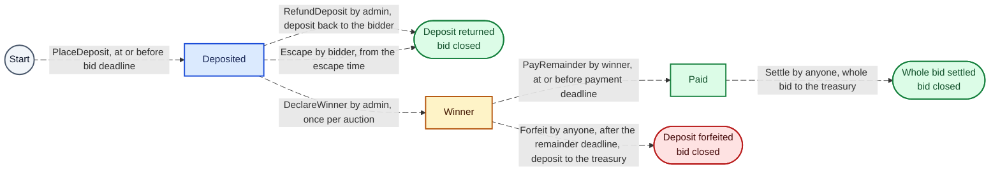
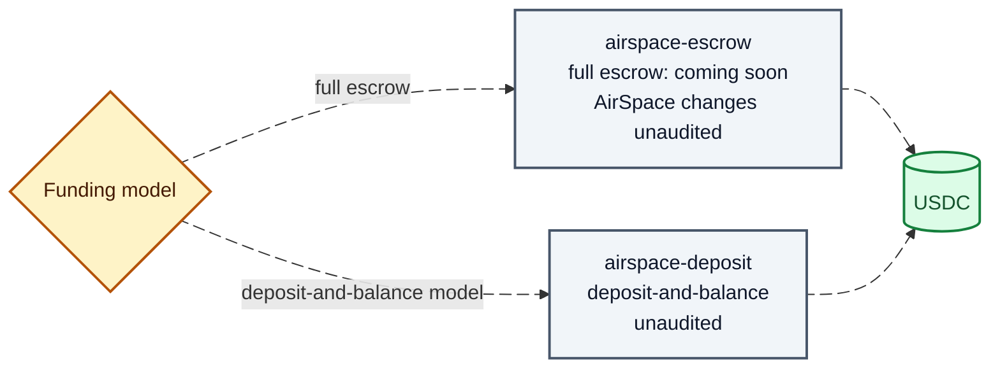

# AirSpace contracts

| Program | Address on Solana Explorer (devnet) |
| --- | --- |
| Escrow | [A2afr3RxBohFjP5zXhEsJDXU3se43dkd8XT2Bm8o5iKc](https://explorer.solana.com/address/A2afr3RxBohFjP5zXhEsJDXU3se43dkd8XT2Bm8o5iKc?cluster=devnet) |
| Deposit-and-balance | [FSoKNTwhgG36NAxu5Axq84yvFZT1ASVz4muVxETwwjKk](https://explorer.solana.com/address/FSoKNTwhgG36NAxu5Axq84yvFZT1ASVz4muVxETwwjKk?cluster=devnet) |

Solana programs for AirSpace, written in Rust with Pinocchio. The repository is a Cargo workspace with two programs, one for each AirSpace funding model.

1. `programs/airspace-escrow` holds the money of a full escrow auction, where every bid is deposited whole. It is a fork of the Solana Foundation escrow program, documented in `docs/PROGRAM.md`.
2. `programs/airspace-deposit` holds the money of a deposit-and-balance auction, where a bidder deposits a share of the bid, the winner pays the rest inside a payment window, and a winner who does not pay forfeits the deposit. It is new code and not a fork, so none of it is audited. It is documented in `docs/DEPOSIT_PROGRAM.md`.
3. `tests/airspace-escrow-tests` and `tests/airspace-deposit-tests` hold the LiteSVM tests of the two programs.
4. `tests/test-hook-program` is a small hook program that the escrow tests use to prove the hook points.

AirSpace is building the deposit-and-balance integration first. Both programs are deployed to devnet for testing; full escrow is coming soon. The deployment record does not establish a completed auction flow with the AirSpace application.

## Where this code comes from

The escrow program is a fork of https://github.com/solana-foundation/escrow at commit `36187ad52c7c03d11b13b6f1da9461f2f757cee2`. That is the commit the upstream audit covers. NOTICE states the origin commit and the license terms.

Audited code: everything that is the same as that commit. Unaudited code: every line that differs from it, which is the list below. Compare the fork with upstream by running `diff -r` between `programs/airspace-escrow/src` and `program/src` of the upstream commit, or by reading the upstream compare view at https://github.com/solana-foundation/escrow/compare/36187ad52c7c03d11b13b6f1da9461f2f757cee2...main for what upstream changed afterwards. The upstream audit status is published in the upstream repository. Mainnet use needs a new audit of the AirSpace changes.

The AirSpace changes:

1. The Codama code generation is removed: its attributes, build script, generated clients, and IDL. Building needs Rust, Pinocchio, and the Solana platform tools only.
2. A Settlement extension (extension type 4) holds a beneficiary, a deposit deadline, and an escape time. SetSettlement (instruction 13) adds it once, and nothing can change or remove it afterwards.
3. Refund (14) and Settle (15) are admin instructions that pay one receipt's whole amount to the depositor or to the beneficiary and close the receipt.
4. Deposit is refused after the deposit deadline, and Withdraw by the depositor is refused before the escape time, when an escrow has settlement terms.
5. Events SettlementSet, Refund, and Settle, and errors 17 to 24, are appended after the upstream ones.

The upstream Arbiter extension (type 3, a third party signer for withdrawals) is untouched. An escrow without settlement terms behaves exactly as upstream.

## Planned full escrow integration

The planned integration creates one escrow per full escrow auction, with its admin key, devnet USDC as the only allowed mint, and the AirSpace treasury as the beneficiary. The admin runs SetSettlement right after creating the escrow and before it allows the mint, so the rules are on chain before the first deposit. Each bid is one receipt for its whole amount. An outbid bid is refunded, and the winning bid is settled to the treasury. The deposit deadline is the end of the auction, and the escape time is one week later, but withdrawal also remains subject to any configured timelock, arbiter approval, and hooks. The escape time alone does not guarantee that a withdrawal succeeds.

The instruction layouts, accounts, and errors are in `docs/PROGRAM.md`.

## Diagrams

These figures explain the Solana programs in this repository, not Stripe payments or proof that an AirSpace auction has completed end to end. The [deployment record](docs/DEVNET_DEPLOYMENT.md) documents devnet testing and retained upgrade authority: the programs can be upgraded. AirSpace's changes and the deposit program have not been independently audited.

**Colors:** blue = sponsor actions; purple = admin control; green = funds or payments; amber = rules or conditions; red = forfeiture; gray = records or endpoints. Arrows show relationships or possible instructions, not automatic payments.

### Figure 1. Escrow — where is my money held?

**For sponsors:** Your tokens are held in an escrow vault, and a receipt records your deposit. Read the settlement recipient and withdrawal conditions before depositing; holding funds in a contract does not remove admin or upgrade authority.

**Verify:** [Escrow accounts and extensions](docs/PROGRAM.md).

### Figure 2. Escrow — who can move my money?

**For sponsors:** You sign deposits and withdrawals; the admin can submit refunds and settlements. Withdrawals also check configured timelocks, arbiter approval, and hooks, so the escape time is not an unconditional refund guarantee.

**Verify:** [Withdrawal checks](programs/airspace-escrow/src/instructions/withdraw/processor.rs) and [admin payout checks](programs/airspace-escrow/src/instructions/admin_payout.rs).

### Figure 3. Escrow — how does my deposit leave the vault?

**For sponsors:** A refund returns your receipt amount to you; settlement sends it to the configured beneficiary. The program checks those recipients, but does not verify that a sponsorship was delivered before the admin settles.

**Verify:** [Refund and settlement implementation](programs/airspace-escrow/src/instructions/admin_payout.rs).

### Figure 4. Deposit-and-balance — what secures my bid?

**For sponsors:** Your deposit sits in the auction vault and your bid record tracks what you paid. The auction fixes its treasury and payment terms at creation; the program computes your deposit from those terms.

**Verify:** [Auction creation](programs/airspace-deposit/src/instructions/create_auction.rs) and [deposit calculation](programs/airspace-deposit/src/state.rs).

### Figure 5. Deposit-and-balance — when do I get a refund or lose my deposit?

**For sponsors:** While your bid remains deposited, the admin can refund it, or you can reclaim it from the escape time. Once declared the winner, you must pay the balance on time or forfeit the deposit; that winning bid cannot escape.

**Verify:** [Escape eligibility](programs/airspace-deposit/src/instructions/escape.rs) and [forfeiture checks](programs/airspace-deposit/src/instructions/forfeit.rs).

### Figure 6. Deposit-and-balance — who picks the winner and when must I pay?

```mermaid
flowchart LR
    Create[Admin creates auction<br/>fixed deposit share and deadlines]
    Deposited[Bidders deposit into the vault]
    Winner[Admin declares one winner<br/>payment window starts]
    Paid[Winner pays the balance into the vault]
    Returned([Deposit returned to bidder<br/>bid closed])
    Settled([Whole bid paid to treasury<br/>bid closed])
    Forfeited([Only deposit paid to treasury<br/>bid closed])
    Create e1@-->|PlaceDeposit: at or before bid deadline| Deposited
    Deposited e2@-->|RefundDeposit: admin refunds a deposited bid| Returned
    Deposited e3@-->|Escape: bidder reclaims at or after escape time| Returned
    Deposited e4@-->|DeclareWinner: admin, after bid deadline| Winner
    Winner e5@-->|PayRemainder: winner, at or before payment deadline| Paid
    Paid e6@-->|Settle: anyone may submit| Settled
    Winner e7@-->|Forfeit: anyone, after payment deadline if unpaid| Forfeited
    e1@{ animation: slow }
    e2@{ animation: slow }
    e3@{ animation: slow }
    e4@{ animation: slow }
    e5@{ animation: slow }
    e6@{ animation: slow }
    e7@{ animation: slow }
    classDef admin fill:#EDE9FE,stroke:#6D28D9,color:#2E1065,stroke-width:2px;
    class Create,Winner admin;
    classDef sponsor fill:#DBEAFE,stroke:#1D4ED8,color:#172554,stroke-width:2px;
    class Deposited sponsor;
    classDef money fill:#DCFCE7,stroke:#15803D,color:#14532D,stroke-width:2px;
    class Paid,Returned,Settled money;
    classDef loss fill:#FEE2E2,stroke:#B91C1C,color:#450A0A,stroke-width:2px;
    class Forfeited loss;
```

**For sponsors:** The admin selects one deposited bid; the program does not rank bids. Your payment window starts at declaration and must end before the escape time; settlement and forfeiture each require someone to submit a transaction.

**Verify:** [Winner declaration](programs/airspace-deposit/src/instructions/declare_winner.rs), [balance payment](programs/airspace-deposit/src/instructions/pay_remainder.rs), and [settlement](programs/airspace-deposit/src/instructions/settle.rs).

### Figure 7. Which payment model am I using?

**For sponsors:** The deposit-and-balance model is the first planned AirSpace integration; full escrow is coming soon. Both program addresses are documented on devnet, which uses test funds; deployment alone does not establish a working sponsorship purchase.

**Verify:** [Deployment scope and verification record](docs/DEVNET_DEPLOYMENT.md).

## Build and test

1. `cargo build-sbf` in `programs/airspace-escrow` and in `programs/airspace-deposit` builds the programs. Build both before running the tests, because the tests load `target/deploy/*.so`.
2. In `tests/test-hook-program`, `cargo build-sbf --features allow` and `cargo build-sbf --features deny` build the two hook programs. Copy `target/deploy/test_hook_program.so` to `test_hook_allow.so` and `test_hook_deny.so` in the same directory after each build.
3. `cargo test` runs the unit tests and the LiteSVM tests.
4. `cargo fmt --all --check` and `cargo clippy --all-targets -- -D warnings` check style.

## Program addresses and security contact

Both programs were deployed to devnet on October 13, 2026. The [devnet deployment record](docs/DEVNET_DEPLOYMENT.md) includes explorer links, upgrade authority, transaction signatures, and binary verification. Both programs carry a `security_txt` that points to this repository and to `SECURITY.md`. Please report vulnerabilities to hello@visitairspace.xyz, as `SECURITY.md` describes.

## Contact

For questions about these programs, audits, or the AirSpace changes, email hello@visitairspace.xyz. Please send security reports privately to the same address, as `SECURITY.md` describes, and do not open a public issue for them.
