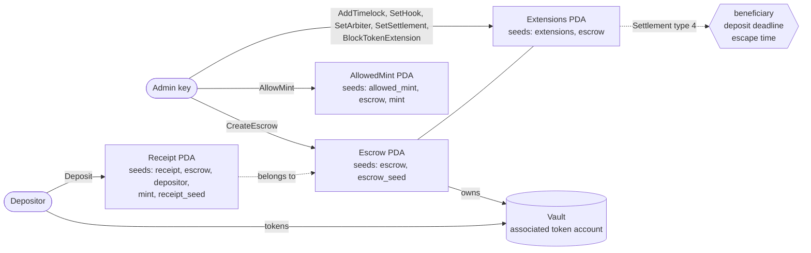
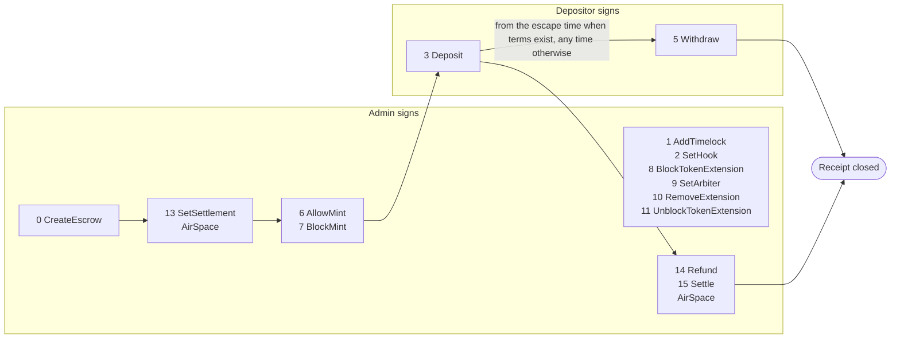
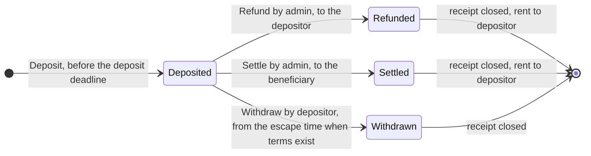
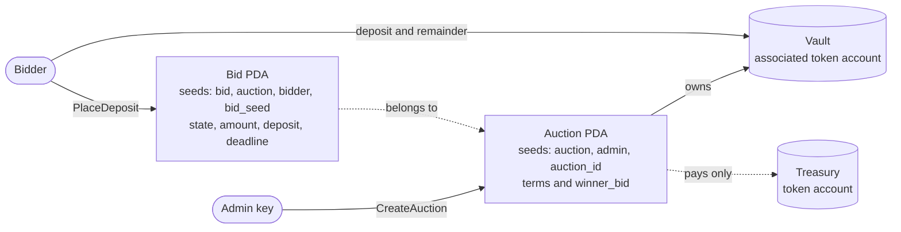
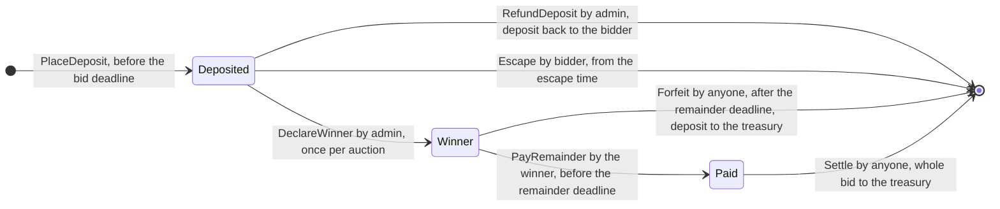
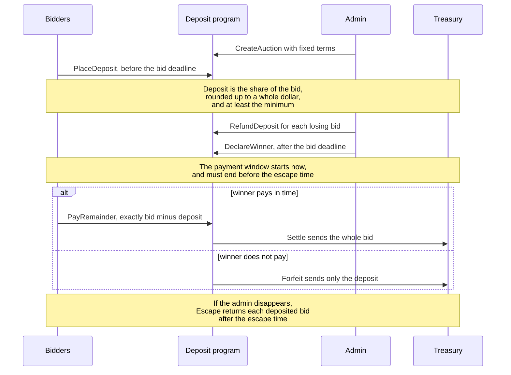
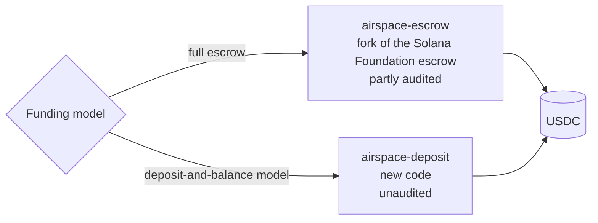

# AirSpace contracts

Solana programs for AirSpace, written in Rust with Pinocchio. The repository is a Cargo workspace with two programs, one for each AirSpace funding model.

1. `programs/airspace-escrow` holds the money of a full escrow auction, where every bid is deposited whole. It is a fork of the Solana Foundation escrow program, documented in `docs/PROGRAM.md`.
2. `programs/airspace-deposit` holds the money of a deposit-and-balance auction, where a bidder deposits a share of the bid, the winner pays the rest inside a payment window, and a winner who does not pay forfeits the deposit. It is new code and not a fork, so none of it is audited. It is documented in `docs/DEPOSIT_PROGRAM.md`.
3. `tests/airspace-escrow-tests` and `tests/airspace-deposit-tests` hold the LiteSVM tests of the two programs.
4. `tests/test-hook-program` is a small hook program that the escrow tests use to prove the hook points.

## Where this code comes from

The escrow program is a fork of https://github.com/solana-foundation/escrow at commit `36187ad52c7c03d11b13b6f1da9461f2f757cee2`. That is the commit the upstream audit covers. NOTICE states the origin commit and the license terms.

Audited code: everything that is the same as that commit. Unaudited code: every line that differs from it, which is the list below. Compare the fork with upstream by running `diff -r` between `programs/airspace-escrow/src` and `program/src` of the upstream commit, or by reading the upstream compare view at https://github.com/solana-foundation/escrow/compare/36187ad52c7c03d11b13b6f1da9461f2f757cee2...main for what upstream changed afterwards. The upstream audit status is published in the upstream repository. Mainnet use needs a new audit of the AirSpace changes.

The AirSpace changes:

1. The Codama code generation is removed: its attributes, build script, generated clients, and IDL. Building needs Rust, Pinocchio, and the Solana platform tools only.
2. A Settlement extension (extension type 4) holds a beneficiary, a deposit deadline, and an escape time. SetSettlement (instruction 13) adds it once, and nothing can change or remove it afterwards.
3. Refund (14) and Settle (15) are admin instructions that pay one receipt's whole amount to the depositor or to the beneficiary and close the receipt.
4. Deposit is refused after the deposit deadline, and Withdraw by the depositor is refused before the escape time, when an escrow has settlement terms.
5. Events SettlementSet, Refund, and Settle, and errors 17 to 24, are appended after the upstream ones.

The upstream Arbiter extension (type 3, a third party signer for withdrawals) is untouched. An escrow without settlement terms behaves exactly as upstream.

## How AirSpace auctions use it

AirSpace creates one escrow per full escrow auction, with its admin key, devnet USDC as the only allowed mint, and the AirSpace treasury as the beneficiary. The admin runs SetSettlement right after creating the escrow and before it allows the mint, so the rules are on chain before the first deposit. Each bid is one receipt for its whole amount. An outbid bid is refunded, and the winning bid is settled to the treasury. The deposit deadline is the end of the auction, and the escape time is one week later, so a bidder can always take their money back on their own if the admin disappears.

The instruction layouts, accounts, and errors are in `docs/PROGRAM.md`.

## Diagrams

### Escrow program: accounts

### Escrow program: instructions and who can send them

### Escrow program: life of one receipt

### Deposit program: accounts

### Deposit program: life of one bid

### Deposit program: timeline of one auction

### Which program an AirSpace auction uses

## Build and test

1. `cargo build-sbf` in `programs/airspace-escrow` and in `programs/airspace-deposit` builds the programs. Build both before running the tests, because the tests load `target/deploy/*.so`.
2. In `tests/test-hook-program`, `cargo build-sbf --features allow` and `cargo build-sbf --features deny` build the two hook programs. Copy `target/deploy/test_hook_program.so` to `test_hook_allow.so` and `test_hook_deny.so` in the same directory after each build.
3. `cargo test` runs the unit tests and the LiteSVM tests.
4. `cargo fmt --all --check` and `cargo clippy --all-targets -- -D warnings` check style.

## Program addresses and security contact

The escrow program address is `A2afr3RxBohFjP5zXhEsJDXU3se43dkd8XT2Bm8o5iKc`, and the deposit program address is `FSoKNTwhgG36NAxu5Axq84yvFZT1ASVz4muVxETwwjKk`. Both were deployed to devnet on October 13, 2026. The [devnet deployment record](docs/DEVNET_DEPLOYMENT.md) includes explorer links, upgrade authority, transaction signatures, and binary verification. Both programs carry a `security_txt` that points to this repository and to `SECURITY.md`. Please report vulnerabilities to hello@visitairspace.xyz, as `SECURITY.md` describes.

## Contact

For questions about these programs, audits, or the AirSpace changes, email hello@visitairspace.xyz. Please send security reports privately to the same address, as `SECURITY.md` describes, and do not open a public issue for them.
